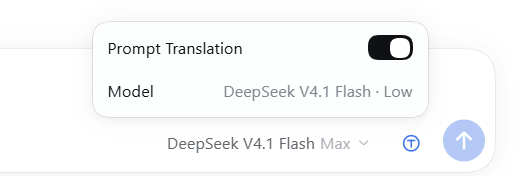

# English Prompt

Translate every prompt into English for the model, and keep the answer in the
language you wrote in — one answer, rendered natively.

## Demo

The circled-T control sits between the model selector and Send. It is blue while
prompt translation is on and black while it is off; clicking it opens the
settings panel above the composer, with the Prompt Translation switch and the
model and reasoning effort the translation request actually uses.

## Install

Paste this sentence into any DeepSeek Harness session:

> Install the DSH plugin from https://github.com/stairclimber/dsh-english-prompt into my current profile: clone the repository, install its package directory as a plugin bundle with the plugin manager, and enable it.

The repository must be reachable by the installing account — make it public or
sign in to GitHub before cloning.

## What it does

- **Prompts → English.** Before a prompt enters the model request — and before it
  becomes the durable user message of the Turn — the Host half asks your own
  configured model (`ctx.llm`, on the Session's model route) for an English
  rendering. Markdown, fenced code, inline code, commands, URLs, file paths, and
  identifiers are preserved. The same call identifies the language you wrote in,
  and the result is cached per message.
- **The answer stays in your language.** A short language rule rides in the
  prompt's runtime context, which the loop re-reads *after* the prompt has been
  translated. It tells the model to write its answer in that language, so the
  answer is produced in your language from the start. The harness renders that one
  answer with its normal Markdown renderer: no second copy, no translation card,
  no English answer shown first.
- **No language drift.** The rule names the language of the *current* prompt in
  every turn, so an English prompt in a Chinese conversation is answered in
  English and the next Chinese prompt is answered in Chinese.
- **Composer control and settings panel.** A circled-T mark sits immediately to the
  right of the model selector, between it and Send. It is drawn as a blue line mark
  while prompt translation is on — using the same fill token as the composer's send
  button — and as a black line mark while it is off; there is no dimmed state.
  Clicking it opens a small settings panel above the composer, styled like the
  model-selection menu:

  | Row | Kind | Value |
  |---|---|---|
  | Prompt Translation | switch (default on) | Enables prompt translation for this Session |
  | Model | display | The model and reasoning effort the plugin actually uses: the Session's route plus the lowest effort the route advertises (`DeepSeek V4.1 Flash · Low`) |

  The Model value is computed by the Host from the session environment (the
  Agent's current model selection resolved through `ctx.llm.resolveModelInfo()`),
  not copied from the composer's model selector, so it shows the auxiliary
  request's real effort rather than the Session's.

  The plugin's own UI text — the button's tooltip, the panel rows, and the
  Plugin Manager title and description — is fixed English and does not follow the
  interface language.

Only text the plugin itself sends is translated; tool arguments, files, and other
Session events are never rewritten. Every auxiliary request carries the Session
identity (routes such as OpenCode require it) and the lowest reasoning effort the
model offers.

## How it works

- `agent/pre-step` translates the human message that enters the step, so English
  is what the model reads and what the Session commits.
- `ctx.systemPrompt.context({ name: 'english-prompt:response-language', order: 1000 })`
  contributes the language rule. Runtime context is re-read by
  `refreshContext()` after `agent/pre-step`, which is why the rule always matches
  the language detected for *this* turn. Chat does not render runtime context, so
  the rule is invisible in the transcript.
- The Client half only renders the button and talks to two loopback routes:
  `GET /english-prompt/state?sessionId=…` and
  `POST /english-prompt/toggle?sessionId=…&enabled=0|1`. `state` also returns the
  resolved `route` (`provider`, `model`, display `name`, and the `effort` the
  auxiliary call will request), which the settings panel shows. Cross-site browser
  requests are refused.

## Configuration

`cordis.patch.yml` carries the row's config:

| Field | Default | Meaning |
|---|---|---|
| `translatePrompts` | `true` | Translate prompts into English. |
| `answerInUserLanguage` | `true` | Make the model answer in the prompt's language. |
| `maxTextChars` | `12000` | Longest prompt text translated in one request. |
| `timeoutMs` | `45000` | Deadline for one auxiliary translation request. |

## Known limits

- The answer language is carried by an instruction, so the model must follow it.
  It is placed last — in the runtime context after the translated prompt — and was
  verified across Chinese/English turns in one conversation.
- The detected language is in-process. After a Host restart it is learned again
  from the next prompt you send.
- Prompts are committed to the Session in English, which is what the transcript
  and every later model step see; the wording you typed is not retained in the
  log.
- Each prompt costs one auxiliary model call, including English prompts, where the
  call confirms the language and returns the text unchanged.
